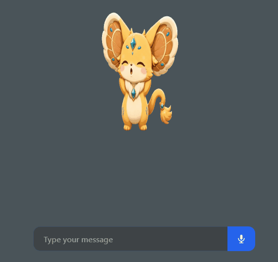

<div align="center">


# Kakarot

**From BitMon — an experimental desktop mascot — to a hardened, Wayland-native systems daemon.**

Voice-first. Sandboxed. Auditable. Memory-bounded.

</div>

---

## The Origins: BitMon

**BitMon** was an experimental, lightweight desktop AI mascot and UI framework. It was built around a simple idea: an animated pet that could live on your desktop, listen to you, think, and talk back.

The original stack was Windows-first and revolved around a character-driven experience:

- **Animated pet overlay** — A PySide6 sprite sheet with distinct states (`idle`, `listening`, `thinking`, `talking`, `startup`, `poke`, `error`).
- **Voice interaction** — Push-to-talk with a configurable hotkey, plus an experimental wake word.
- **Pluggable backends** — Support for Inworld (cloud) and a fully-local path using LM Studio + Kokoro.
- **Local speech processing** — WhisperX for STT, with TTS handled by either Inworld or Kokoro.
- **Extensibility** — A visual persona editor for building custom pets, Home Assistant integration via MCP, and a tray-based launcher.
- **Web configuration UI** — A FastAPI-served control panel to manage providers, personas, and behavior.

### Legacy BitMon UI Footprint

These are the original BitMon-era assets, preserved here to show where the project started:

<div align="center">

| | |
| :--: | :--: |
|  |  |
| *Original BitMon hero art* | *Original BitMon in action* |

</div>

<div align="center">

| | |
| :--: | :--: |
|  |  |
|  |  |
|  |  |

*BitMon's original web configuration UI and tray launcher.*
</div>

BitMon was never meant to be a system agent. It was a playful experiment in human-computer interaction — a proof of concept for a voice-driven desktop companion. The UI, sprite framework, and core ideas would go on to become the foundation for something far more serious.

---

## The Evolution: Building Kakarot

Kakarot took the existing BitMon UI framework, sprite assets, and interaction model, then pivoted hard from a novelty mascot to a **hardened, Wayland-native systems daemon**. The character remained, but the runtime was rebuilt from the ground up with production-grade constraints.

### Core Architectural Shifts

| System | BitMon (Origin) | Kakarot (Current) |
| --- | --- | --- |
| **Execution Model** | Long-lived FastAPI backend with persistent WebSocket sessions | Headless `systemd --user` daemon with a stateless control plane (D-Bus + private UNIX socket) |
| **AI Transport** | Inworld streaming or LM Studio local calls, often via WebSocket (`/session`) | **Stateless `google.genai` REST pipeline** (unary/SSE). WebSockets have been dropped entirely. |
| **Voice Endpointing** | Primarily provider-driven or simple VAD | **Local Silero VAD** for precise endpointing with an energy-based fallback. Barge-in and follow-up are opt-in. |
| **Execution Safety** | Local token auth and in-process tool dispatch | Strict **Bubblewrap (`bwrap`) sandbox** with an AST-based command gate, graded Human-in-the-Loop (HITL), and a privacy scrubber. |
| **Microphone Control** | Often active on launch | **Cold-boot mute (`IDLE_MUTED`)**. The microphone remains closed until explicit `unmute` via UDS or D-Bus. |
| **Desktop Integration** | Windows tray + PySide6 overlay | **Native GNOME on Wayland**. GTK4/libadwaita control window, PyQt6 floating mascot. No system tray or AppIndicator dependency. |
| **State & Memory** | In-memory history with file-based config | SQLite WAL + FTS5 for memory/reminders, keyring-backed credentials (with encrypted fallback), and a persistent, rotating audit log. |
| **Resource Discipline** | "Install everything" — eager loading of local models | Daemon capped at **192 MiB** (`MemoryHigh=128M`/`MemoryMax=192M`). Heavy work is offloaded to bounded subprocesses and sandboxed helpers. |

### Key Implementation Details

- **Stateless REST over WebSockets**: Kakarot's voice turns go through unary/SSE calls to `google.genai`. By dropping persistent WebSockets, the daemon avoids the memory leaks and lifecycle issues that plague long-running live connections in a sandboxed environment.
- **Silero VAD for local endpointing**: The daemon uses a bundled Silero ONNX model for speech detection, loaded on-demand rather than at import time. This keeps the cold path lean while still catching natural turn boundaries without relying on the model to decide when the user has stopped speaking.
- **Bubblewrap sandboxing**: Every external command goes through `kakarot_daemon/sandbox.py`. The sandbox builds an empty root, binds only whitelisted system paths read-only, masks `$HOME` and `/run/user`, re-exposes only `Documents`/`Downloads`/`Desktop` when they exist, drops all capabilities, and isolates the network by default. Shell operators trigger human approval regardless of which binary is invoked.
- **Defense in depth**: Clipboard uses `wl-copy`/`wl-paste` (never `xclip`/`xsel`), screen access goes through XDG Desktop Portals, notifications use `org.freedesktop.Notifications`, and the privacy scrubber redacts secrets before logs or outbound requests.

---

## The 3-Tier Agency UI & Visual Showcase

Kakarot replaced BitMon's blocking modal approvals with a **non-modal, 3-tier Agency UI**. The goal is simple: ask for help without stealing focus or breaking flow.

### The FloatingAgencyStrip

The mascot now features a hidden-by-default **`FloatingAgencyStrip`** docked beneath it. When intervention is required, it surfaces contextually with:

- **Graded agency levels** — `input`, `decision`, `action`, and `critical`, each with distinct visual accents.
- **Clear context** — A reason, prompt, and label are shown so the user knows exactly why Kakarot is pausing.
- **Actionable choices** — Dynamic option chips (e.g., "Approve", "Reject", or custom actions). For `action`-level requests, the default is often `"I'm done"`.
- **Non-blocking** — Responses are sent over the same UDS/D-Bus control plane. The window never locks up or forces a modal dialog.
- **Backward compatible** — The UI still accepts legacy events like `hitl_prompt` and `auth_request`, but all new flows emit `human_required`.

This is the heart of Kakarot's "agency with restraint" philosophy: the agent can propose, but mutating or ambiguous actions require explicit human consent.

### Updated UI Showcase

The new interface reflects Kakarot's hardened, system-focused identity. Below is the current UI state, including the required demonstration of the agency interface:

<div align="center">


*The 3-tier floating agency dock (`FloatingAgencyStrip`) in action. This is the new Human-in-the-Loop interface that replaced BitMon's blocking approval modals.*
</div>

<div align="center">

| | |
| :--: | :--: |
|  |  |
| *Kakarot identity (GTK4/libadwaita control window context)* | *Kakarot in motion* |

</div>

> **Note on the required asset:** The file `image_25985e.png` is included verbatim in this section as requested to demonstrate the interface.

---

## Quick Start (Linux / Wayland)

> **Reference target:** Fedora + GNOME Wayland, Python 3.12, PipeWire, `bwrap`, `wl-clipboard`.

```bash
# Clone
git clone https://github.com/BhattAyush17/Kakarot.git
cd Kakarot

# Environment
python3 -m venv venv
venv/bin/pip install --upgrade pip
venv/bin/pip install -r requirements.txt
venv/bin/pip install -r requirements-mascot.txt

# Desktop integration (systemd, D-Bus, icon)
./install_gui.sh

# Configure Gemini
venv/bin/python3 -m kakarot_daemon.daemon configure
systemctl --user restart kakarot-core.service

# Unmute (boots muted by design)
venv/bin/python3 -m kakarot_daemon.daemon control unmute
venv/bin/python3 -m kakarot_daemon.daemon control status
```

**Front ends:**
- GTK4 control window: `/usr/bin/python3 -m kakarot_gui`
- Floating PyQt6 mascot: `venv/bin/python3 -m kakarot_overlay`

**Control plane (D-Bus):**
```bash
gdbus call --session \
  --dest io.github.kakarot.Daemon \
  --object-path /io/github/kakarot/Daemon \
  --method io.github.kakarot.Daemon.Status
```

---

## Project Layout

```text
kakarot_daemon/      Headless daemon (state, audio, Gemini REST, tools, sandbox, memory, audit)
kakarot_gui/         GTK4/libadwaita control window (system Python)
kakarot_overlay/     PyQt6 mascot + FloatingAgencyStrip
core/                Config, keyring/secret storage, security
persona/             Original BitMon sprite overlay (preserved for compatibility)
services/            Legacy providers/session helpers (BitMon compatibility path)
tools/               Screen/Home Assistant tools (legacy + integrations)
docs/images/         BitMon legacy assets + Kakarot imagery
tests/               Pytest suite for daemon, sandbox, HITL, audio, memory
```

---

## Documentation

- [`AGENTS.md`](AGENTS.md) — Development contract and boundaries
- [`docs/assistant/`](docs/assistant/) — Requirements, architecture, delivery plan, validation gates
- [`docs/mascot.md`](docs/mascot.md) — Mascot runtime and socket path
- [`docs/`](docs/) — Legacy BitMon documentation (retained for compatibility)

---

## Tests

```bash
venv/bin/python3 -m pytest -q
```

Covers cold-start mute, audio lifecycle, Gemini session/tool behavior, graded HITL, Bubblewrap policy and private-path blocking, memory/reminders, and lightweight runtime imports.

---

<div align="center">

<sub>Kakarot · Evolved from BitMon · Hardened for Wayland · Sandboxed · Auditable · Memory-bounded</sub>

</div>
