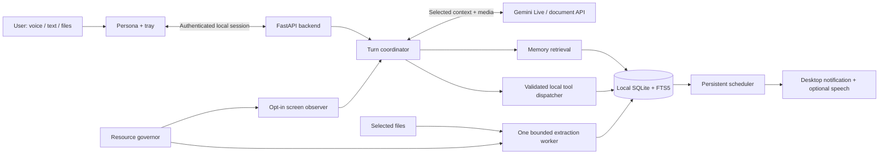

# Target architecture

## Process model

Retain the existing FastAPI backend and PySide6 persona. Refactor launcher supervision so a second full Qt runtime does not remain resident solely to supervise an already resident persona if measurements show it is unnecessary. Initially measure all three existing processes; merging launcher/tray responsibilities is a gated optimization, not a prerequisite rewrite.

The backend owns state and cloud credentials. The persona owns capture/playback and visible interaction. Parsers run outside the UI/event loop in a disposable process with enforceable limits. No separate database server, vector service, browser runtime, or resident local ML model is required.

## Integration map

All new paths below are proposed repository-relative paths. Existing paths are verified in the inspection record.

| Existing surface | Change | Proposed new component |
|---|---|---|
| main.py lifespan and session | Capability-based startup, Gemini routing, clean scheduler shutdown | services/runtime.py, services/gemini_session.py |
| services/llm_bridge.py | Lazy provider adapters; Gemini text/document selection | services/gemini_client.py |
| services/chat_session.py, services/local_session.py | Preserve legacy pipelines; share tool/memory contracts | services/turn_context.py |
| services/chat_bus.py | Bounded event transport; durable history through memory API | services/events.py |
| core/config_defaults.py, config_models.py, config_store.py | New fields, migration, public/private config separation | Existing config modules extended |
| core/config.py, secret_store.py | Gemini credential getter and secure storage | Existing secret modules extended |
| core/security.py | New route families and WebSocket token/origin checks | Existing auth helpers extended |
| services/tool_runtime.py | Memory, task, reminder and source lookup tools | tools/memory_tools.py, tools/reminder_tools.py |
| tools/screen_tools.py | Gemini image route; portable capture abstraction | services/capture.py |
| persona/personagem.py | Streaming audio, bounded queues, attachments, capability negotiation | Existing persona retained |
| launcher.py, services/process_control.py | Platform-aware startup and owned-process tracking | Packaging scripts and startup profile |
| web/config.html | Gemini, memory, roots, sharing, budgets, reminder controls | Existing settings UI extended |
| requirements-core.txt and installers | Lightweight versus legacy/parser extras | requirements-light.txt, constraints files |

## Voice/session protocol

Preserve the existing /session endpoint while adding a protocol version and capability handshake. Inventory existing emitted/consumed event shapes before editing; do not assume Gemini packets are compatible with the current clip-oriented flow. Server capability response declares audio rates, enabled tools, and limits. Existing clients retain the legacy path.

Implement states: disconnected → connecting → ready → listening/responding → reconnecting → ready, plus stopping and error. Cancellation flushes local playback, cancels pending response work, and invalidates late chunks using a turn generation ID. A bounded reconnect backoff must never replay a side effect automatically.

Gemini Live provides audio, image/text input and tool use. Its documented PCM rates are 16 kHz input and 24 kHz output; normalize explicitly at the adapter boundary and verify against the selected model/SDK. [Official Live API overview](https://ai.google.dev/gemini-api/docs/live-api)

For voice memory retrieval, use a local memory_search function available to Gemini, with a small initial profile/project context. Finalized transcripts may trigger prefetch, but do not rely on partial transcription arriving before the model answers. Grounded questions must obtain tool results before claiming remembered facts. This avoids a race between native audio generation and local retrieval.

Document reasoning uses a separate bounded request to a supported Gemini document/text model, with selected local excerpts or selected rendered pages; Live is not assumed to accept arbitrary Office files. [Document processing](https://ai.google.dev/gemini-api/docs/document-processing)

## Proposed service contracts

- MemoryStore.remember(record, operation_id), search(query, scope, limit), correct(id, revision), forget(id).
- SourceIndex.schedule(path), status(job_id), cancel(job_id), remove(source_id).
- ReminderService.create(spec, operation_id), cancel(id), list_active(), reconcile(now).
- ContextBuilder.build(request, project_id, sharing_policy, token_budget) returns evidence items and an outbound manifest.
- ToolDispatcher.execute(name, validated_args, authority, operation_id) returns ok, result, error_code, retryable.
- Event envelope: version, event_id, type, turn_id, timestamp, payload. Never inject timer events as fabricated user requests.

Proposed local API families: /api/memory, /api/sources, /api/jobs, /api/tasks, /api/reminders, /api/observation, /api/diagnostics. Authenticate reads as well as writes because paths and memories are private. Paginate list endpoints; reject oversized payloads before decoding. Use stable structured errors (unsupported_format, resource_limit, source_changed, offline, unauthorized).

## Timer correctness

Persist UTC deadlines and original timezone/recurrence semantics. Use monotonic waits while running; recalculate after restart, clock changes, and resume. Transactionally claim a due occurrence and insert an outbox notification with a unique reminder/occurrence key. The notifier retries failed deliveries; OS delivery and database commit are not one atomic transaction, so promise at-least-once delivery with deduplication where the platform supports it, not perfect exactly-once display. Default overdue policy: show one grouped catch-up notification after resume. A powered-off laptop cannot alert.

## Resource governance

At 400 MB, suspend indexing and optional observation. At 450 MB, stop the extraction worker and discard reconstructible media caches. Use admission control and OS worker limits before these thresholds; a polling watchdog alone cannot prevent allocation spikes. At the 500 MB boundary, record a failed release run even if recovery works. Preserve committed data and notifications; do not hide budget failures by silently increasing limits.

## Architecture decisions

| ADR | Decision | Reason / reconsideration trigger |
|---|---|---|
| A01 | Keep Python/FastAPI/PySide6 initially | Reuse existing UI/protocol; reconsider only after S1 profiling |
| A02 | Gemini native audio as default | Avoid local STT/TTS models; depends on network |
| A03 | SQLite + FTS5 locally | Small operational footprint; evaluate semantic additions only if retrieval benchmark fails |
| A04 | Two resident roles, one transient parser | Isolate resource spikes while preserving UI responsiveness |
| A05 | No automatic whole-file cloud upload | Selected content suffices for most tasks; explicit future upload mode can have separate lifecycle policy |
| A06 | Event-driven indexing, opt-in observation | Avoid constant scanning and uncontrolled context growth |
